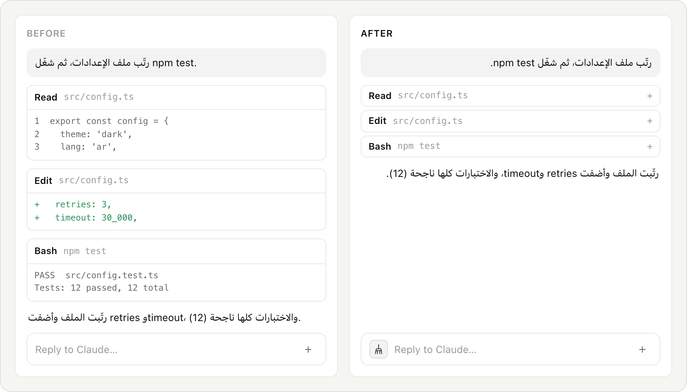
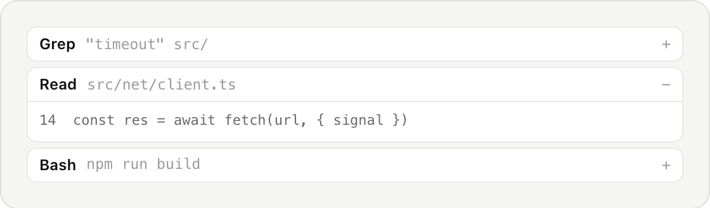
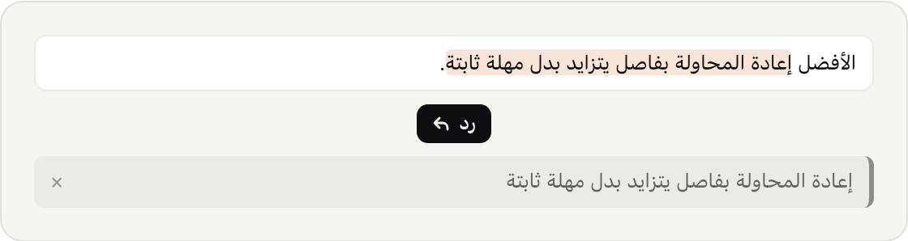
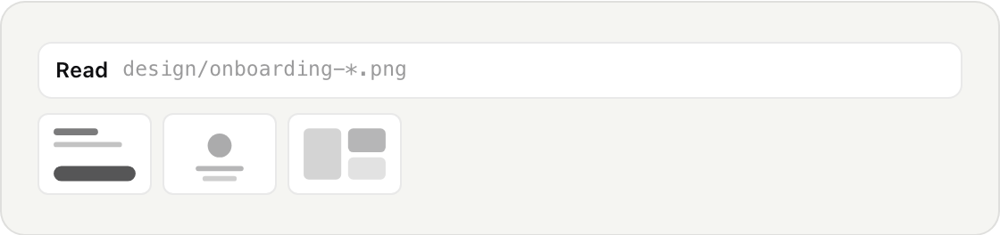
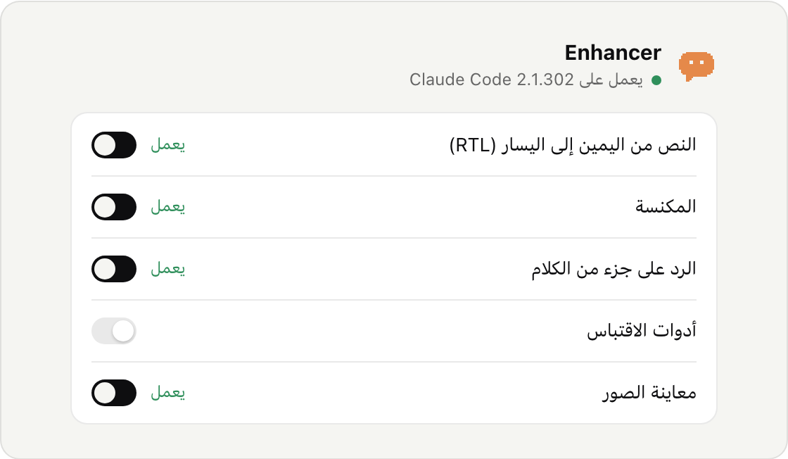

<div dir="rtl">

<p align="center">
  <picture>
    <source media="(prefers-color-scheme: dark)" srcset="assets/readme/banner-ar-dark.png">
    
  </picture>
</p>

<p align="center">إضافة مستقلة لمحادثة Claude Code داخل VS Code. لا علاقة لنا بـ Anthropic.</p>

<p align="center">
  <a href="#install-and-remove">التثبيت في VS Code</a> &rlm;·&rlm;
  <a href="https://open-vsx.org/extension/enhancer/enhancer-for-claude-code">Open VSX</a> &rlm;·&rlm;
  <a href="README.md">English</a>
</p>

</div>

> [!NOTE]
> <p dir="rtl">تعدّل Enhancer ملفات Claude Code نفسها لتضيف هذه الميزات. تحتفظ بالنسخ الأصلية، وزر <b>إرجاع Claude Code إلى أصله</b> يعيدها حرفًا بحرف. <a href="#exactly-what-gets-changed">ماذا نغيّر بالضبط</a></p>

<div dir="rtl">

<p align="center">
  <picture>
    <source media="(prefers-color-scheme: dark)" srcset="assets/readme/before-after-ar-dark.png">
    
  </picture>
</p>

<p align="center"><b>اختر كل ميزة بنفسك، وأعِد الملفات الأصلية متى شئت.</b></p>

<a id="install-and-remove"></a>
## التثبيت والإزالة

- **VS Code:** افتح الإضافات، وابحث عن **Enhancer for Claude Code** وثبّتها.
- **Cursor وOrnus وVSCodium** وكل محرر يستخدم Open VSX: البحث نفسه.
- تُفتح لوحة التحكم. اضغط **شغّل التحسينات** ثم أعد تحميل النافذة.
- للإزالة: اضغط **إرجاع Claude Code إلى أصله** وانتظر حتى تظهر **متوقّف** في اللوحة، ثم احذف الإضافة. والحذف نفسه يحاول الاستعادة تلقائيًا أيضًا.

<a id="compatibility"></a>
## التوافق

[](https://marketplace.visualstudio.com/items?itemName=enhancer.enhancer-for-claude-code)
[](https://open-vsx.org/extension/enhancer/enhancer-for-claude-code)
[](LICENSE)

فحوص دورية تركّب كل ميزة على أحدث نسخ Claude Code، ثم تركّبها مرة ثانية، ثم تعيد الملفات الأصلية حرفًا بحرف. [آخر النتائج](compat/README.md)

| Claude Code | ماك (Apple silicon) | ويندوز (x64) | آخر فحص |
|---|---|---|---|
| 2.1.302 | ✅ 5 من 5 | لم يُجرَّب بعد | 17 أكتوبر |
| 2.1.301 | ✅ 5 من 5 | لم يُجرَّب بعد | 17 أكتوبر |
| 2.1.300 | ✅ 5 من 5 | لم يُجرَّب بعد | 17 أكتوبر |

هذه فحوص تركيب واستعادة: تُثبت أن الميزة تُركَّب وتُزال بنظافة، لا أنها جُرّبت داخل محادثة حقيقية. ومع كل نسخة جديدة من Claude Code تجرّب Enhancer كل ميزة، والميزة التي لا تنجح في فحوصها تبقى خارجًا وتظهر **بانتظار تحديث**.

## ماذا تضيف

### النص من اليمين إلى اليسار

العربية والعبرية والفارسية والأردية وباقي اللغات المدعومة التي تُكتب من اليمين تُقرأ في اتجاهها الصحيح، ويبقى الكود والإنجليزي من اليسار.

<picture>
  <source media="(prefers-color-scheme: dark)" srcset="assets/readme/rtl-ar-dark.png">
  
</picture>

### المكنسة

ضغطة على المكنسة تطوي كل صفوف الأدوات إلى سطر واحد، وتبقى الصفوف الجديدة مطويّة. ضغطة ثانية تفتحها، أو افتح صفًّا واحدًا بزر + الخاص به.

<picture>
  <source media="(prefers-color-scheme: dark)" srcset="assets/readme/broom-dark.png">
  
</picture>

### الرد على جزء من الكلام

حدّد جزءًا من رد Claude واضغط «رد». يذهب النص المحدَّد مع رسالتك التالية كاقتباس.

<picture>
  <source media="(prefers-color-scheme: dark)" srcset="assets/readme/quote-reply-ar-dark.png">
  
</picture>

### أدوات الاقتباس

انسخ الاقتباس أو حدّده بضغطة، بلا النص الذي حوله.

<picture>
  <source media="(prefers-color-scheme: dark)" srcset="assets/readme/quote-tools-ar-dark.png">
  
</picture>

### معاينة الصور

الصور التي يقرؤها Claude أو يكتبها تظهر مصغّرة داخل المحادثة. اضغط لتكبيرها، أو افتح الملف في المحرر.

<picture>
  <source media="(prefers-color-scheme: dark)" srcset="assets/readme/image-preview-dark.png">
  
</picture>

### لكل ميزة مفتاحها

تبقى ملفات Claude Code كما هي حتى تضغط **شغّل التحسينات**. أطفئ ما لا تريده، ويبقى الباقي يعمل.

<picture>
  <source media="(prefers-color-scheme: dark)" srcset="assets/readme/panel-ar-dark.png">
  
</picture>

<a id="exactly-what-gets-changed"></a>
## ماذا نغيّر بالضبط

ثلاثة ملفات على الأكثر داخل مجلد إضافة Claude Code، ولا شيء غيرها:

| الملف | لماذا |
|---|---|
| `webview/index.css` | شكل كل ميزة |
| `webview/index.js` | عملها داخل المحادثة |
| `extension.js` | لمعاينة الصور فقط: قراءة الصورة لعرضها |

قبل أول تغيير تحفظ Enhancer نسخة أصلية. كل تغيير محصور بين علامات واضحة باسم Enhancer، والاستعادة تعيد النسخة الأصلية المحفوظة حرفًا بحرف.

<a id="privacy"></a>
## الخصوصية

- بلا حساب. لا تجمع Enhancer كودك ولا محادثاتك.
- البحث عن نسخة جديدة يسأل متجر الإضافات في محرّرك (Visual Studio Marketplace أو Open VSX) عن آخر نسخة، وأخبار Ornus تقرأ ملفًا صغيرًا من ornus.ai. الاثنان يعملان من البداية، ولكل منهما مفتاحه.
- الاقتراحات لا تُرسل إلا حين تضغط «إرسال»: رسالتك، وبريد اختياري، والتفاصيل التقنية التي تتركها محدَّدة. وتصل إلى الفريق عبر ornus.ai.

## المزيد في Ornus

Ornus مساحة عمل بالذكاء الاصطناعي مبنية على VS Code، من الصنّاع أنفسهم. بعض الأشياء مكانها هناك:

- تنبيه وصوت حين ينتهي Claude · *متوفّر في Ornus*
- الكتابة بالصوت بالعربية · *متوفّر في Ornus*
- مراجعة تعديلات عدة ملفات معًا · *قادم إلى Ornus*

[نزّل Ornus ←](https://ornus.ai/download?utm_source=enhancer&utm_medium=readme)

## إذا حدث خطأ

عطّل Enhancer أو احذفها من الإضافات أولًا، حتى لا تعيد تعديلاتها حين يبدأ المحرر. ثم إعادة تثبيت Claude Code من الإضافات ترجع ملفاته الأصلية. وإذا لم يفتح المحرر أصلًا، فأداة الاستعادة المرفقة (تحتاج Node.js) تعيدها من الطرفية:

<div dir="ltr">

```sh
node "<enhancer-folder>/out/cli.js" restore "<claude-code-folder>"
```

</div>

## المساهمة

الأفكار وبلاغات الأخطاء مرحّب بها في Issues، أو من زر **أرسل اقتراحًا** في اللوحة. كل ميزة وصفة صغيرة واحدة في `src/recipes/` مع اختباراتها.

---

رخصة Apache-2.0. اسم Enhancer وشخصيته غير مشمولين بالرخصة (انظر [NOTICE](NOTICE)). لا علاقة لنا بـ Anthropic، وClaude وClaude Code علامتان تجاريتان لـ Anthropic. صُنع باستخدام Ornus.

</div>
