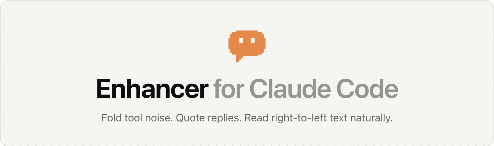
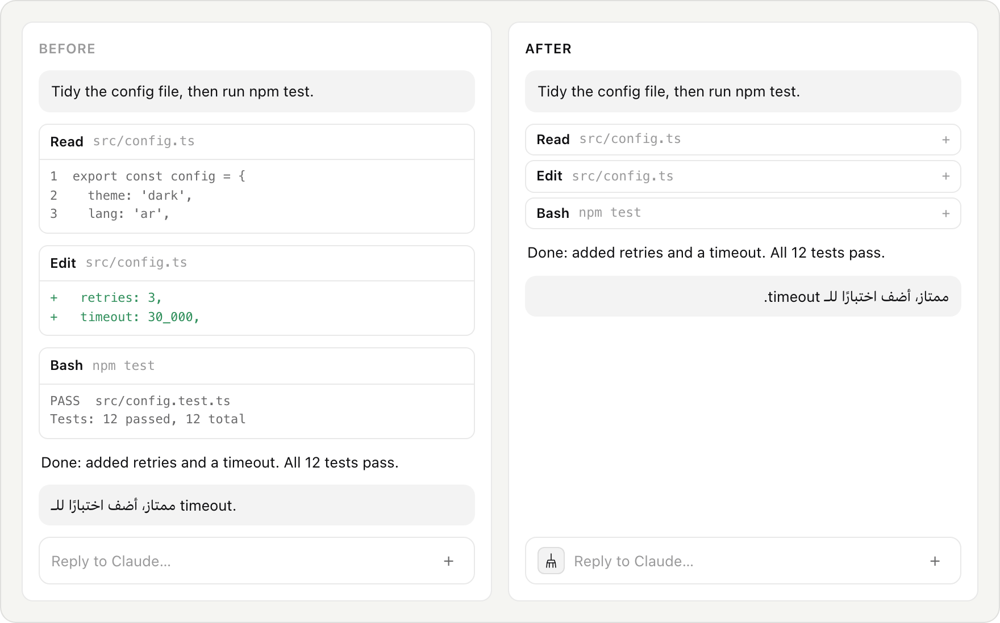
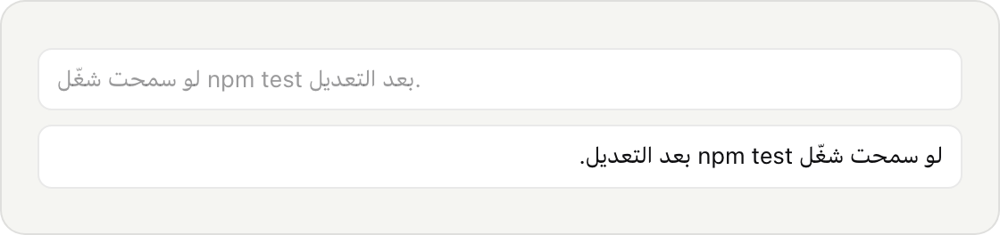
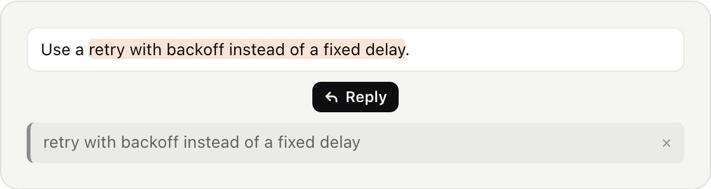
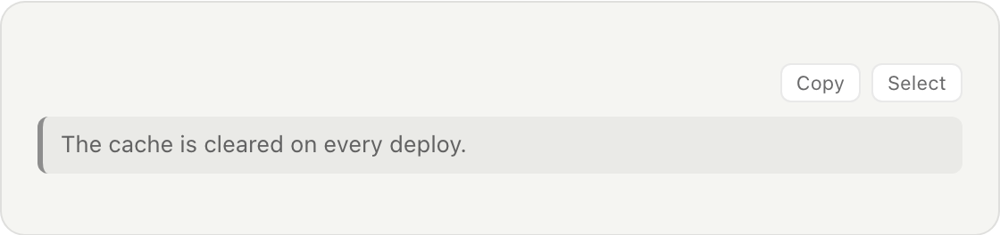
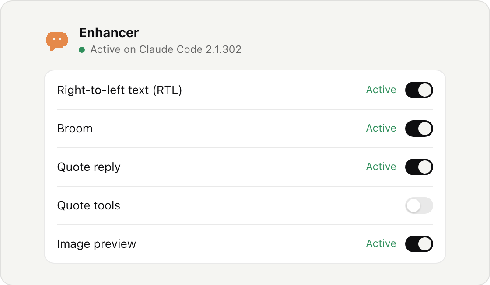

<p align="center">
  <picture>
    <source media="(prefers-color-scheme: dark)" srcset="assets/readme/banner-en-dark.png">
    
  </picture>
</p>

<p align="center">An independent extension for Claude Code's chat in VS Code. Not affiliated with Anthropic.</p>

<p align="center">
  <a href="#install-and-remove">Install for VS Code</a> ·
  <a href="https://open-vsx.org/extension/enhancer/enhancer-for-claude-code">Open VSX</a> ·
  <a href="README.ar.md">العربية</a>
</p>

> [!NOTE]
> Enhancer changes Claude Code's own files to add these features. It keeps the originals, and **Restore** puts them back byte for byte. [Exactly what it changes](#exactly-what-gets-changed)

<p align="center">
  <picture>
    <source media="(prefers-color-scheme: dark)" srcset="assets/readme/before-after-en-dark.png">
    
  </picture>
</p>

<p align="center"><b>Choose each feature. Restore the original files anytime.</b></p>

<a id="install-and-remove"></a>
## Install and remove

- **VS Code:** open Extensions, search for **Enhancer for Claude Code** and install it.
- **Cursor, Ornus, VSCodium** and other editors using Open VSX: the same search.
- The control panel opens. Press **Turn on enhancements**, then reload the window.
- To remove: press **Restore original Claude Code** and wait until the panel shows **Off**, then uninstall. Uninstalling also tries to restore by itself.

<a id="compatibility"></a>
## Compatibility

[](https://marketplace.visualstudio.com/items?itemName=enhancer.enhancer-for-claude-code)
[](https://open-vsx.org/extension/enhancer/enhancer-for-claude-code)
[](LICENSE)

Scheduled checks apply every enhancement to recent Claude Code releases, apply it again, then restore the original files byte for byte. [Latest results](compat/README.md)

| Claude Code | macOS (Apple silicon) | Windows (x64) | Checked |
|---|---|---|---|
| 2.1.302 | ✅ 5 of 5 | Not verified yet | Oct 17 |
| 2.1.301 | ✅ 5 of 5 | Not verified yet | Oct 17 |
| 2.1.300 | ✅ 5 of 5 | Not verified yet | Oct 17 |

These are patch and restore checks: they prove an enhancement fits and undoes cleanly, not that it was used in a live chat. On a new Claude Code version, Enhancer tries each enhancement; one that fails its checks is left out and shows **Waiting for an update**.

## What it adds

### Right-to-left text

Arabic, Hebrew, Persian, Urdu and the other supported right-to-left scripts read in the right direction. Code and English stay left to right.

<picture>
  <source media="(prefers-color-scheme: dark)" srcset="assets/readme/rtl-en-dark.png">
  
</picture>

### The broom

Click the broom to fold every tool row to one line, and new rows stay folded. Click again to unfold, or open a single row with its +.

<picture>
  <source media="(prefers-color-scheme: dark)" srcset="assets/readme/broom-dark.png">
  
</picture>

### Quote reply

Select part of Claude's answer and press Reply. The selected text goes with your next message as a quote.

<picture>
  <source media="(prefers-color-scheme: dark)" srcset="assets/readme/quote-reply-en-dark.png">
  
</picture>

### Quote tools

Copy or select a quoted block in one click, without the text around it.

<picture>
  <source media="(prefers-color-scheme: dark)" srcset="assets/readme/quote-tools-en-dark.png">
  
</picture>

### Image preview

Images Claude reads or writes show as thumbnails right in the chat. Click to zoom, or open the file in the editor.

<picture>
  <source media="(prefers-color-scheme: dark)" srcset="assets/readme/image-preview-dark.png">
  
</picture>

### Every enhancement has its own switch

Claude Code's files stay unchanged until you press **Turn on enhancements**. Turn off what you don't want, and the rest keeps working.

<picture>
  <source media="(prefers-color-scheme: dark)" srcset="assets/readme/panel-en-dark.png">
  
</picture>

<a id="exactly-what-gets-changed"></a>
## Exactly what gets changed

Up to three files inside the Claude Code extension folder, nothing else:

| File | Why |
|---|---|
| `webview/index.css` | The look of each enhancement |
| `webview/index.js` | Their behaviour in the chat |
| `extension.js` | Image preview only: reading an image to show it |

Before the first change, Enhancer keeps an original copy. Every change sits between clear Enhancer markers, and Restore puts the saved original bytes back.

<a id="privacy"></a>
## Privacy

- No account. Enhancer does not collect your code or your conversations.
- The update check asks your editor's extension store (Visual Studio Marketplace or Open VSX) for the latest version, and Ornus news reads a small file from ornus.ai. Both are on by default, each with its own switch.
- Feedback is sent only when you press Send: your message, an optional email and the technical details you leave ticked. It reaches the team through ornus.ai.

## More in Ornus

Ornus is an AI workspace built on VS Code, made by the same people. A few things live there instead:

- Notifications and sound when Claude finishes · *Available in Ornus*
- Arabic voice input · *Available in Ornus*
- Multi-file diff review · *Coming to Ornus*

[Download Ornus →](https://ornus.ai/download?utm_source=enhancer&utm_medium=readme)

## If something goes wrong

First disable or uninstall Enhancer in Extensions, so it does not apply its changes again when the editor starts. Then reinstalling Claude Code from Extensions brings back its original files. If the editor won't open, the bundled recovery tool (it needs Node.js) restores them from a terminal:

```sh
node "<enhancer-folder>/out/cli.js" restore "<claude-code-folder>"
```

## Contributing

Ideas and bug reports are welcome in Issues, or through **Send feedback** in the panel. Each enhancement is one small recipe in `src/recipes/` with its own tests.

---

Apache-2.0. The Enhancer name and its mascot are not covered by the license (see [NOTICE](NOTICE)). Not affiliated with Anthropic; Claude and Claude Code are trademarks of Anthropic. Built with Ornus.
